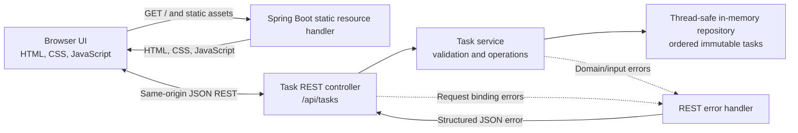
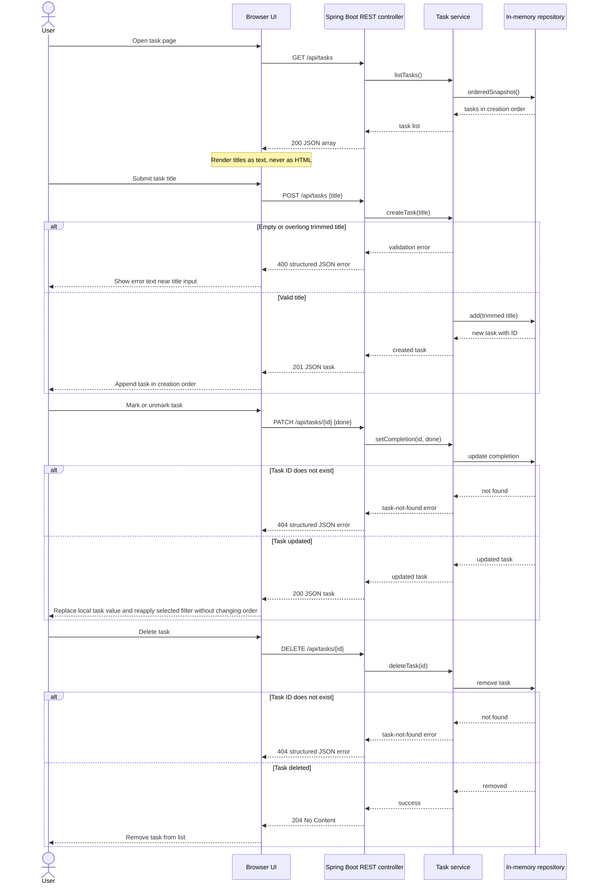

# Architecture

## 1. Context and Goals

The application is a single-user task manager served by one Spring Boot process. The browser UI and REST API are same-origin; task data is held in memory and is lost on restart.

| Goal | Requirement IDs |
|---|---|
| Create, list, complete, uncomplete, and delete tasks; validate titles and report missing tasks | FR-1, FR-3, FR-5, FR-6 |
| Preserve creation order and provide All, Active, and Done views with the specified filter behavior | FR-2, FR-7, FR-8, FR-9 |
| Provide the `/api/tasks` REST API and in-memory server storage | FR-4, NFR-2, NFR-6, NFR-11 |
| Meet the stated concurrency, response-time, startup, data-volume, browser, responsive, and accessibility requirements | NFR-3, NFR-4, NFR-5, NFR-6, NFR-7, NFR-8, NFR-9, NFR-10 |
| Keep the implementation within the required Spring Boot and plain HTML/CSS/JavaScript stack | NFR-1, NFR-12 |

## 2. Component Diagram

## 3. Components and Responsibilities

| Component | Responsibility | Requirement IDs |
|---|---|---|
| Browser UI | Provide task entry, completion checkbox, deletion, and All/Active/Done controls using real buttons and checkboxes; keep the selected filter in page memory and reset to All on reload; preserve order while filtering; support keyboard and touch use; show accessible labels, focus, and errors; render server-provided strings as text. | FR-1, FR-2, FR-5, FR-6, FR-7, FR-8, FR-9, NFR-4, NFR-7, NFR-8, NFR-9, NFR-10 |
| Spring Boot runtime and static resource handler | Start the application and serve the plain HTML, CSS, and JavaScript on the same origin as the API. | NFR-1, NFR-5, NFR-12 |
| Task REST controller | Expose task operations under `/api/tasks`, bind JSON requests, and return JSON responses and appropriate HTTP statuses. | FR-1, FR-3, FR-4, FR-5, FR-6, NFR-2, NFR-4 |
| Task service | Trim Unicode whitespace and validate titles on the server, enforce the 100-code-point limit, and coordinate create, list, completion, and deletion operations. | FR-1, FR-2, FR-3, FR-4, FR-5, FR-6, NFR-4 |
| In-memory task repository | Store immutable task values in insertion order, assign IDs, and synchronize ID allocation and map access so overlapping requests cannot corrupt the store; return detached ordered snapshots for reads. | FR-2, FR-4, FR-8, NFR-3, NFR-6, NFR-11 |
| REST error handler | Convert validation, request-binding, method-not-allowed, and missing-task failures into the consistent JSON error response; avoid returning implementation details for unexpected server errors. | FR-3, FR-6, NFR-9 |

## 4. Data Flow

## 5. Technology Choices

| Area | Choice and rationale | Alternatives rejected |
|---|---|---|
| Backend and runtime | Java 17 with Spring Boot REST controllers and static resource serving, as fixed by the project stack. A single process serves both UI and API. | A separate frontend server or separate API service would add deployment and cross-origin configuration without a requirement benefit. |
| Build and tests | Maven, JUnit 5, and Spring Boot Test with MockMvc, as fixed by the project stack. MockMvc can verify route, status, JSON, validation, and not-found behavior without starting a browser. | A second test framework or a separate API test service is unnecessary. |
| Frontend | Plain HTML, CSS, and JavaScript served from `src/main/resources/static`. The UI fetches the complete list and filters it in the browser. At the specified 1,000-task limit, this avoids extra endpoints and filter state synchronization. | A frontend framework and server-side filter query parameter would add dependencies and API complexity. |
| Storage and ordering | A synchronized insertion-ordered `LinkedHashMap<Long, Task>` of immutable task values in one repository. A monotonically assigned numeric ID and insertion order preserve creation order; updates replace the value at its existing key without changing order. ID allocation and map access use the same lock, and reads return detached ordered snapshots. | A database conflicts with the in-memory requirement. A concurrent map plus a separate ordering/indexing mechanism adds moving parts for this single-user, 1,000-task application. |
| API representation | JSON task objects use `id`, `title`, and `done`. IDs are positive numeric values assigned by the repository. | Timestamps, priority, and due-date fields are not required and are omitted. |
| Client-side filtering | The browser applies All, Active, or Done to the ordered list returned by the API. The selected filter exists only in page memory and initializes to All. | Persisting filter state or adding filter-specific server endpoints is outside the requirement and adds state/route complexity. |

## 6. Error Handling and Security Approach

### REST API contract

| Method and route | Behavior | Success response |
|---|---|---|
| `GET /api/tasks` | Return all tasks in creation order. An empty store is not an error. | `200 OK`, JSON array (empty array when there are no tasks) |
| `POST /api/tasks` | Create from `{"title":"..."}` after trimming and validating the title. | `201 Created`, JSON task: `{"id":1,"title":"...","done":false}` |
| `PATCH /api/tasks/{id}` | Set completion state from `{"done":true}` or `{"done":false}`. Updating a task does not change its order. | `200 OK`, updated JSON task |
| `DELETE /api/tasks/{id}` | Delete the identified task. | `204 No Content` |

### Error handling

- Errors from the documented `/api/tasks` operations use `application/json` and the shape `{"error":{"code":"...","message":"..."}}`. The message is plain text that identifies the problem.
- Empty, whitespace-only, and over-100-code-point trimmed titles return `400 Bad Request` with code `INVALID_TITLE`. Messages are respectively `Title must not be empty.` and `Title must be 100 characters or fewer.`
- An unknown numeric task ID on `PATCH` or `DELETE` returns `404 Not Found`, code `TASK_NOT_FOUND`, and a message such as `Task 42 was not found.`
- Malformed JSON, a non-boolean `done` value, or a non-numeric path ID returns `400 Bad Request` with code `INVALID_REQUEST` and a message describing the invalid request.
- An unsupported method on a documented route returns `405 Method Not Allowed` with code `METHOD_NOT_ALLOWED` in the same format. A centralized Spring `@RestControllerAdvice` maps these documented-operation errors to the response schema. Unexpected server errors return a generic `500 Internal Server Error` response and do not expose stack traces. The UI displays API and network errors as text near the title input.
- Client-side checks may improve immediate feedback, but server-side validation is authoritative. The service trims boundary code points that satisfy `Character.isWhitespace` or `Character.isSpaceChar`, then checks blank titles and counts Unicode code points with `codePointCount(0, title.length())`.

### Security and reliability

- Task titles and API error messages are untrusted strings. The UI creates DOM nodes and assigns dynamic strings with `textContent` (and form values with `.value`); it never interpolates task data into HTML or uses `innerHTML`. Static application markup remains separate from task data. This prevents a title such as `` from being interpreted as executable markup.
- The service validates title content and length before storing it; browser validation is not trusted as a security boundary.
- The app has no login or user-specific data, as required. The UI and API are same-origin, so no CORS setup is needed. This design assumes local or otherwise trusted use and is not an authenticated multi-user service.
- Repository methods synchronize access to the ordered map, keep task values immutable, and return detached snapshots rather than exposing mutable backing state. This supports safe reads/writes when requests overlap while preserving insertion order.
- After a successful completion update, the UI replaces the task in its local ordered list and reapplies the currently selected filter. A task marked done therefore leaves Active and appears in Done; unmarking reverses that behavior without changing its All-list position.
- Verification should cover route/status/error contracts, title trimming and code-point boundaries, ordering, missing IDs, thread-safe store behavior, and safe rendering of markup-looking titles. Use JUnit 5 and MockMvc for backend behavior; use a browser-level check for the DOM rendering guarantee, since API tests cannot establish how the UI handles text.
- For the performance targets, measure API operations and page updates with 1,000 tasks on a typical developer laptop, record the environment and observed times, and compare them with the 500 ms API and 1 second UI limits. Record startup time against the 15 second target.

### Assumptions

- A monotonically increasing numeric task ID is sufficient; IDs and tasks reset when the process restarts.
- “100 characters” is interpreted as 100 Unicode code points after trimming; combining sequences may contain multiple code points. A boundary code point is trimmed when either `Character.isWhitespace` or `Character.isSpaceChar` returns true.
- Duplicate task titles are allowed because no uniqueness rule was specified.
- The browser fetches all tasks and filters the list locally; the API does not expose filter parameters.
- Error codes and messages shown above are the selected API contract for documented operations. No deletion confirmation or custom empty-state behavior is required.
- Performance and startup targets are acceptance constraints to verify; no external database, cache, or separate service is introduced to meet them.
